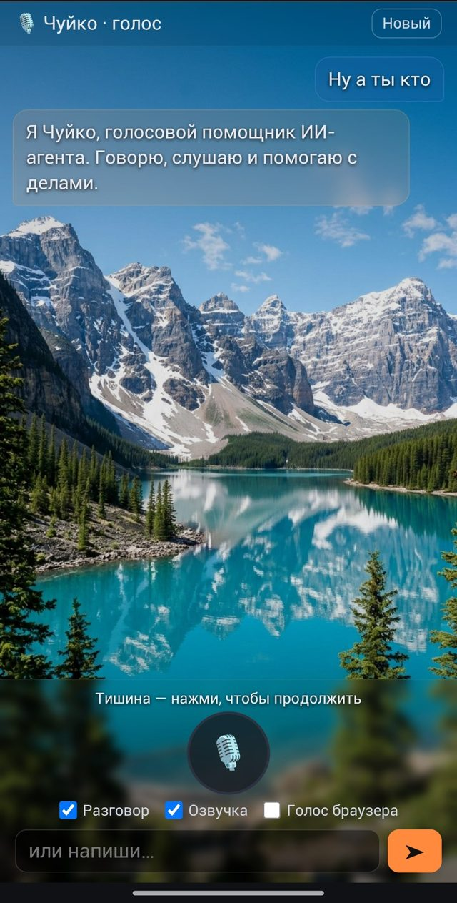

# Чу́йко (Chuyko) — поговори со своим ИИ-агентом голосом

Чу́йко — это голосовая связь с твоим ИИ-агентом **прямо с телефона**, откуда угодно.
Открываешь страницу, нажимаешь на микрофон и говоришь. Агент отвечает вслух, а весь разговор
остаётся на экране текстом.

<p align="center"></p>

## Что умеет

- 🎙️ **Слышит тебя.** Речь в текст переводит сам телефон. Ничего ставить не нужно, нужен только браузер Chrome.
- 🧠 **Отвечает твой агент, а не чужой чат-бот.** Он помнит прошлые разговоры, умеет всё то же, что и обычно,
  и видит твои файлы и заметки. Чу́йко только передаёт ему твои слова и возвращает ответ.
  Проверено с [Hermes Agent](https://github.com/NousResearch/hermes-agent), подойдут и другие агенты.
- 🔊 **Отвечает голосом.** Лучше всего бесплатный голос [Silero](https://github.com/AstroiLL/silero-tts-service)
  на твоём же сервере: без интернет-сервисов и подписок, с правильными ударениями, английские слова читает
  по-русски. Один такой «голос» можно поставить на весь дом, и им будут пользоваться все. Можно взять и
  платный голос из интернета, например от OpenAI. А можно ничего не ставить: тогда ответы читает встроенный
  голос телефона.
- 💬 **Режим «Разговор».** Говоришь и слушаешь, ничего не нажимая, как по телефону.
- 🖼️ **Свой фон.** Скажи «поставь фоном горное озеро», и агент нарисует картинку и поставит её.
- 📓 **Дневник.** Если хочешь, все разговоры записываются в заметки, например в [Obsidian](https://obsidian.md).
  Это отличная бесплатная программа для заметок. Заметки хранятся обычными файлами у тебя на компьютере,
  а не в чужом облаке, поэтому никуда не пропадут. Она работает на телефоне и компьютере и умеет связывать
  заметки между собой. Со временем они складываются в настоящую «вторую память»: в ней легко найти,
  о чём ты говорил с агентом неделю назад.
- 🏷️ **Видно, с кем говоришь.** В верхней строке после «Чу́йко» написано, к какому агенту ты подключён:
  его адрес или имя. Адрес можно заменить на понятное имя, например «Чу́йко · Киклоп» или
  «Чу́йко · Сервер на даче». Удобно, когда агентов несколько. Просто скажи агенту:
  «подпиши агента в шапке как Киклоп».
- 🌐 **Страницу открыли по новому адресу?** Если в верхней строке видно что-то непонятное вроде
  `http://127.0.0.1:8642`, а страница уже открывается по нормальному адресу из интернета, скажи агенту:
  «смени адрес в шапке на внешний». Потом обнови страницу.
- 📱 **Как обычное приложение.** Чу́йко можно добавить на главный экран телефона и открывать одним касанием.
  Вход по секретному ключу, посторонние не зайдут.

## Как это работает

```
 Телефон                         Твой сервер                     ИИ-агент
 ты говоришь → текст   ──────►  Чу́йко  ───── вопрос ─────────►  Hermes или другой
 слушаешь ответ        ◄──────    │    ◄──── ответ по словам ──
                                  └──► голос Silero (на этом или другом компьютере)
```

Чтобы понять твою речь, Chrome отправляет её в Google. Всё остальное, то есть ответы агента и голос,
остаётся на твоём сервере.

## Спасибо этим проектам

Чу́йко сделан с их помощью. В комплект они не входят и ставятся отдельно:

- [silero-tts-service](https://github.com/AstroiLL/silero-tts-service) — общий «голос» для всех на основе
  [Silero](https://github.com/snakers4/silero-models) (© Silero Team). Он бесплатен для личного пользования,
  а для бизнеса нужна лицензия Silero.
- [FastAPI](https://fastapi.tiangolo.com), [Uvicorn](https://www.uvicorn.org), [HTTPX](https://www.python-httpx.org) —
  на них работает сам Чу́йко.
- Иконка из [Noto Emoji](https://github.com/googlefonts/noto-emoji) (Google).
- [Hermes Agent](https://github.com/NousResearch/hermes-agent) — агент, с которым Чу́йко сделан и проверен.

## Автор и лицензия

Илья Брызгалов (Ilya Byven) aka [@AstroiLL](https://github.com/AstroiLL) — [astroill.info](https://astroill.info)

Лицензия [MIT](LICENSE): пользуйся как хочешь, в том числе для заработка. Просим только сохранять имя автора.

---

## 🤖 Для агента: установка

Тебя попросили установить Чуйко. Полная пошаговая инструкция с проверками лежит в **[INSTALL.md](INSTALL.md)**.
Если репозиторий приватный, клонируй его по ключу только для чтения, который дал пользователь (INSTALL.md, шаг 2).
Кратко:

1. Нужны Linux, Python 3.10+, около 150 МБ на диске и агент с OpenAI-совместимым `/v1/chat/completions`
   (для Hermes нужно включить API Server).
2. `git clone` → `./install.sh`: создаёт venv, ставит зависимости, создаёт `.env` с токеном.
3. Голос (INSTALL.md, шаг 4): найди готовый silero-tts-service (`~/.config/silero-tts/client.env` указывает
   на сервис в сети, `127.0.0.1:7470` — на этом сервере), проверь, какой TTS
   у агента, и **спроси пользователя**, что использовать: готовый сервис, поставить новый, платный TTS
   агента или голос браузера.
4. Заполнить в `.env` `AGENT_URL` и `AGENT_KEY`, установить systemd-сервис из `deploy/chuyko.service`.
5. Дать HTTPS через reverse proxy (`deploy/Caddyfile.example`), иначе браузер не даст доступ к микрофону.
6. Проверить по чек-листу из INSTALL.md и отдать пользователю ссылку и токен.
